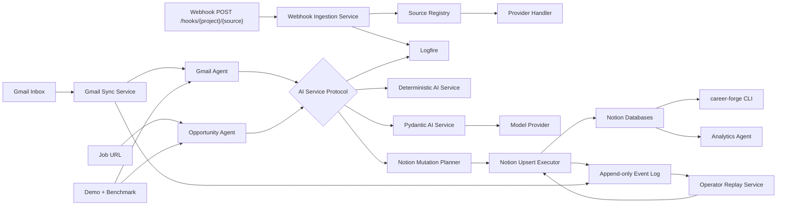

# Architecture

CareerForge is a local Python automation platform with Notion as the system of
record and provider adapters around every external source. Its public showcase
uses the same application paths with deterministic, credential-free adapters.



## Layers

| Layer | Purpose |
| --- | --- |
| `models/` | Shared typed contracts across agents and providers |
| `automation/` | Event-specific planners such as Gmail ingestion |
| `providers/` | External provider adapters, kept out of business logic |
| `ingestion/` | Orchestrates provider extraction and evaluation |
| `evaluation/` | Produces structured opportunity reasoning |
| `agents/` | Thin role-based coordinators |
| `api/` | FastAPI app factory and HTTP route modules |
| `application/webhooks/` | Provider-neutral webhook ingestion, registry, verification, and idempotency |
| `infrastructure/webhooks/` | Header redaction, queue placeholders, and observability helpers |
| `notion/` | Existing direct Notion API repositories |
| `providers/notion/` | Notion mutation planning, execution, and HTTP gateway |
| `gmail/` | Gmail OAuth client and checkpointed sync service |
| `events/` | Append-only JSONL workflow event log |
| `operator_loop.py` | Replay-oriented inspection and apply service for planned Notion mutations |
| `state/` | Local checkpoint and processed-source state |
| `ai/` | Service protocols, mock/real factory, prompt codecs, deterministic rules, and live Pydantic AI adapter |
| `showcase/` | Credential-free orchestration and stable demo output |
| `benchmark/` | Versioned 20-prompt correctness and latency suite |
| `analytics/` | Pure analytics functions |
| `cli.py` | Daily operator interface |

## AI Service Boundary

`EmailClassificationService` and `OpportunityEvaluationService` are the small
application-facing contracts. `career_ops.ai.factory.build_ai_service()` is the
single configuration boundary used when Gmail and job-ingestion pipelines do
not receive an injected service. `CAREER_FORGE_MODE=mock` selects
`MockAIService`; `CAREER_FORGE_MODE=real` validates provider credentials and
selects `PydanticAIService` with implicit local fallback disabled.

`PydanticAIService` handles live model calls and observability.
`DeterministicAIService` owns reproducible rules behind `MockAIService`; it does
not imitate provider I/O. Agents and workflows consume typed protocols and
therefore do not branch on runtime mode.

This split removes hidden exception-driven demo behavior while keeping mock and
real outputs compatible with the same live service contract.

## Prompt-Codec Boundary

`career_ops.ai.prompts` is isolated from provider construction. Its
`build_email_classifier_prompt()` and `build_opportunity_evaluator_prompt()`
functions encode typed inputs as versioned JSON. Its
`parse_email_classifier_output()` and `parse_opportunity_evaluator_output()`
functions validate provider output back into Pydantic domain models.

This boundary keeps prompt serialization and response validation independently
testable, prevents raw model text from leaking into agents, and lets the real
adapter change provider mechanics without changing application contracts.

## Runtime and Compatibility Contract

CareerForge supports Python 3.10, 3.11, and 3.12. Mock mode is the default and
requires no credentials:

```bash
CAREER_FORGE_MODE=mock ./demo.sh --json
CAREER_FORGE_MODE=mock uv run python benchmark/bench.py
```

Real mode is an explicit operator decision:

```bash
CAREER_FORGE_MODE=real \
CAREER_FORGE_PYDANTIC_AI_MODEL=openai:gpt-5.2 \
CAREER_FORGE_OPENAI_API_KEY='replace-with-a-secret' \
uv run career-forge setup validate
```

Real credentials belong in environment variables or encrypted GitHub Actions
secrets. Default CI execution is guarded by `CAREER_FORGE_MODE=mock` and never
receives provider secrets; future live-provider checks must be isolated from
pull requests and the default CI path.

## Benchmark and CI Evidence

The fixed 20-prompt benchmark publishes exactly these top-level JSON fields:
`n`, `median_ms`, `p95_ms`, `throughput_per_min`, `success_rate`, and `details`.
Each `details` record contains exactly `prompt_id`, `latency_ms`, `success`, and
`error`. The fresh deterministic release measurement is:

| Field | Value |
| --- | ---: |
| `n` | 20 |
| `median_ms` | 0.0144865 |
| `p95_ms` | 0.048673 |
| `throughput_per_min` | 2,626,056.166964651 |
| `success_rate` | 1.0 |

GitHub Actions runs coverage on Python 3.10–3.12 with mock mode explicit. A
dependent Python 3.12 quality job runs Ruff, formatting, Pyright, the benchmark,
the host mock demo, and the non-root Docker mock demo, then uploads a fresh
`benchmark-results.json` artifact.

## Provider Boundary

Job providers implement:

```python
class JobProvider(Protocol):
    name: str
    def can_handle(self, url: str) -> bool: ...
    def extract(self, url: str, html: str) -> JobPosting: ...
```

Adding a provider should only require a new provider class and registration in
`providers/jobs/registry.py`.

## Webhook Boundary

Incoming webhooks use the domain convention:

```text
https://hooks.concordmanage.com/{project-name}/{source-name}
```

The current live route is:

```text
POST /hooks/career-forge/notion
```

Route handlers stay thin. They validate route variables, enforce the configured
body-size limit, parse JSON, and pass raw body bytes plus headers to
`WebhookIngestionService`. Source-specific behavior is selected by
`WebhookSourceRegistry`, with handler and verifier abstractions for future
sources such as Gmail, Google Calendar, GitHub, Greenhouse, Lever, Ashby,
LinkedIn, Indeed, and internal agent callbacks.

Webhook receipts currently use an in-memory `WebhookReceiptStore` for local
development. Production deployment should replace it with durable SQLite,
Postgres, or the project storage layer before running multiple workers.

## Notion Write Strategy

The mutation planner produces `NotionMutation` objects instead of blindly
writing. Each mutation includes:

- target database
- action (`upsert`)
- dedupe key
- normalized properties

The Phase 3 executor supports dry-run mode, retry events, duplicate prevention,
and a live HTTP gateway that upserts by `Dedupe Key` when Notion credentials are
configured.

Phase 8 adds a replayable operator layer:

- `career-forge notion plan --latest` reads the latest
  `notion.mutation.planned` event and prints the serialized mutation.
- `career-forge notion apply --latest --dry-run` replays the latest unapplied
  plan without writing to Notion.
- `career-forge notion apply --latest --no-dry-run --confirm` is the explicit
  live apply path.
- low-confidence mutation plans carry review metadata and are refused by replay
  unless explicitly confirmed after review.
- live apply validates that the target database has a `Dedupe Key` rich-text
  property before upserting.

Old event records remain readable because new replay fields have defaults.
