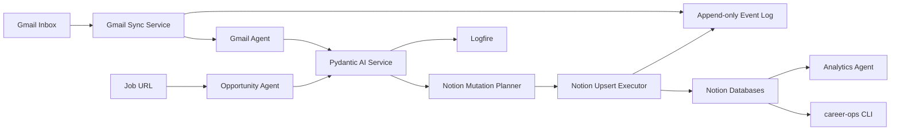

# Architecture

Career Ops is a local Python automation platform with Notion as the system of
record and provider adapters around every external source.



## Layers

| Layer | Purpose |
| --- | --- |
| `models/` | Shared typed contracts across agents and providers |
| `automation/` | Event-specific planners such as Gmail ingestion |
| `providers/` | External provider adapters, kept out of business logic |
| `ingestion/` | Orchestrates provider extraction and evaluation |
| `evaluation/` | Produces structured opportunity reasoning |
| `agents/` | Thin role-based coordinators |
| `notion/` | Existing direct Notion API repositories |
| `providers/notion/` | Notion mutation planning, execution, and HTTP gateway |
| `gmail/` | Gmail OAuth client and checkpointed sync service |
| `events/` | Append-only JSONL workflow event log |
| `state/` | Local checkpoint and processed-source state |
| `ai/` | Pydantic AI service and prompt-versioned structured outputs |
| `analytics/` | Pure analytics functions |
| `cli.py` | Daily operator interface |

## Provider Boundary

Job providers implement:

```python
class JobProvider(Protocol):
    name: str
    def can_handle(self, url: str) -> bool: ...
    def extract(self, url: str, html: str) -> JobPosting: ...
```

Adding a provider should only require a new provider class and registration in
`providers/jobs/registry.py`.

## Notion Write Strategy

The mutation planner produces `NotionMutation` objects instead of blindly
writing. Each mutation includes:

- target database
- action (`upsert`)
- dedupe key
- normalized properties

The Phase 3 executor supports dry-run mode, retry events, duplicate prevention,
and a live HTTP gateway that upserts by `Dedupe Key` when Notion credentials are
configured.
