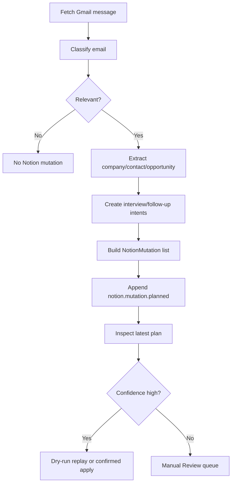

# Automations

## Gmail to Notion



Implemented:

- Pydantic AI-backed classification in `ai/pydantic_ai_service.py`
- checkpointed Gmail polling in `gmail/sync.py`
- company/contact/opportunity/application extraction
- interview and follow-up planning
- audit events
- dedupe key generation
- Notion mutation intent planning
- latest mutation plan inspection and replay
- dry-run/live Notion execution in `providers/notion/executor.py`
- Notion `Dedupe Key` schema validation before live apply
- append-only workflow events in `events/log.py`
- local `career-forge run-once --dry-run` runner

Manual wiring still required:

- Gmail API OAuth credentials at `.career_forge/gmail_credentials.json`
- cron or launchd wiring for scheduled local execution
- Notion database `Dedupe Key` properties for live upserts
- Gmail filters/labels if they should be managed outside code

Primary Phase 8 command sequence:

```bash
career-forge setup validate
career-forge ingest-gmail --dry-run
career-forge notion plan --latest
career-forge notion apply --latest --dry-run
career-forge run-once --dry-run
```

Live apply remains explicit:

```bash
career-forge notion apply --latest --no-dry-run --confirm
```

Broad Gmail dry-runs do not acknowledge messages, advance checkpoints, or mark
local state as processed.

## Job URL Ingestion

Scaffolded provider classes:

- Lever
- Greenhouse
- Ashby
- Workday
- LinkedIn
- Indeed

Flow:

1. User pastes URL.
2. Registry selects provider by host.
3. Fetcher retrieves HTML.
4. Provider extracts `JobPosting`.
5. Evaluator creates `OpportunityEvaluation`.
6. Ingestion pipeline returns `JobIngestionResult`.
7. Notion planner creates company and opportunity upsert intents.

Unsupported URLs return `needs_human_review=True`.

## Webhook Intake

External webhook providers should call:

```text
https://hooks.concordmanage.com/{project-name}/{source-name}
```

The first supported source is:

```text
https://hooks.concordmanage.com/career-forge/notion
```

GitHub is also accepted as an observable automation trigger:

```text
https://hooks.concordmanage.com/career-forge/github
```

Local development maps the public domain to the FastAPI route:

```text
https://hooks.concordmanage.com/career-forge/notion
  -> http://localhost:<api-port>/hooks/career-forge/notion
```

The automation path is intentionally short:

1. Route resolves `(project_name, source_name)` through the registry.
2. Raw body and redacted headers are normalized into a `WebhookEnvelope`.
3. A provider verifier runs when configured; Notion currently reports
   `not_configured`.
4. A deterministic dedupe key is generated and checked against the receipt
   store.
5. The source handler emits safe structured metadata and returns an
   acknowledgement without long-running business processing.

Future webhook sources should add a handler, optional verifier, registry entry,
tests, and a source-specific Logfire channel.

## GitHub to Linear

Linear is the execution system for engineering work. Notion should not duplicate
GitHub issue or PR state unless that state becomes durable career knowledge.

Current local support:

- `career-forge/github` webhook routing
- redacted header handling
- idempotent receipt keys
- source-specific Logfire channel metadata

Planned automation sequence:

1. GitHub emits issue, pull request, review, or check-suite events.
2. Career Forge records the event through the webhook intake path.
3. A GitHub-to-Linear planner decides whether the event needs a Linear issue,
   comment, status transition, or no action.
4. Linear receives the execution update.
5. Notion receives only durable summaries, decisions, or career-search records.

Keep the ownership boundary strict:

- GitHub owns code, pull requests, checks, and repository-native review.
- Linear owns execution workflow, priorities, project state, and next actions.
- Notion owns long-term context, reusable knowledge, and career records.

## Confidence and Fallback

Email confidence is 0-1 because it represents classifier certainty. Opportunity
evaluation confidence is 0-100 because it scores extraction completeness.

Fallback behavior:

- unsupported provider: manual review
- missing key posting fields: manual review
- uncertain email classification: manual review
- newsletter or ignore: no mutation
- API credentials missing: dry-run/planning mode

## Logfire

Configure Logfire with either:

```bash
logfire --base-url='https://logfire-us.pydantic.dev' auth
logfire --base-url='https://logfire-us.pydantic.dev' projects use --org 'dillon-barendt' 'career-forge'
```

or:

```bash
export CAREER_FORGE_LOGFIRE_TOKEN=<write-token>
```

`LOGFIRE_TOKEN` is supported as a compatibility fallback, but
`CAREER_FORGE_LOGFIRE_TOKEN` is preferred.

The code calls `logfire.configure()` and `logfire.instrument_pydantic_ai()` when
the package is installed. Spans are created for Gmail polling, Gmail message
processing, AI classification/evaluation, and Notion mutation execution.
Pydantic AI content capture is disabled by default to avoid sending raw email or
job posting text as trace content.

Phase 8 also registers counters for Gmail message outcomes, Notion mutation
outcomes, and operator replay commands. The metrics avoid raw subject lines,
message bodies, email addresses, and other high-cardinality payload content.
