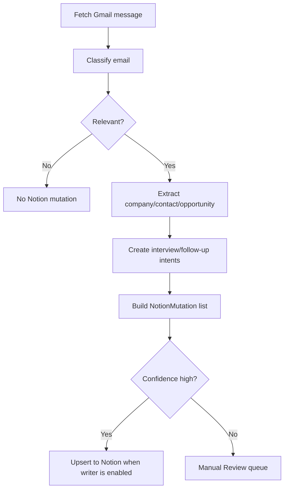

# Automations

## Gmail to Notion



Implemented:

- Pydantic AI-backed classification in `ai/pydantic_ai_service.py`
- checkpointed Gmail polling in `gmail/sync.py`
- company/contact/opportunity/application extraction
- interview and follow-up planning
- audit events
- dedupe key generation
- Notion mutation intent planning
- dry-run/live Notion execution in `providers/notion/executor.py`
- append-only workflow events in `events/log.py`

Manual wiring still required:

- Gmail API OAuth credentials at `.career_ops/gmail_credentials.json`
- polling/scheduled execution
- Notion database `Dedupe Key` properties for live upserts
- Gmail filters/labels if they should be managed outside code

## Job URL Ingestion

Scaffolded provider classes:

- Lever
- Greenhouse
- Ashby
- Workday
- LinkedIn
- Indeed

Flow:

1. User pastes URL.
2. Registry selects provider by host.
3. Fetcher retrieves HTML.
4. Provider extracts `JobPosting`.
5. Evaluator creates `OpportunityEvaluation`.
6. Ingestion pipeline returns `JobIngestionResult`.
7. Notion planner creates company and opportunity upsert intents.

Unsupported URLs return `needs_human_review=True`.

## Confidence and Fallback

Email confidence is 0-1 because it represents classifier certainty. Opportunity
evaluation confidence is 0-100 because it scores extraction completeness.

Fallback behavior:

- unsupported provider: manual review
- missing key posting fields: manual review
- uncertain email classification: manual review
- newsletter or ignore: no mutation
- API credentials missing: dry-run/planning mode

## Logfire

Configure Logfire with either:

```bash
logfire --base-url='https://logfire-us.pydantic.dev' auth
logfire --base-url='https://logfire-us.pydantic.dev' projects use --org 'dillon-barendt' 'career-ops'
```

or:

```bash
export CAREER_OPS_LOGFIRE_TOKEN=<write-token>
```

`LOGFIRE_TOKEN` is supported as a compatibility fallback, but
`CAREER_OPS_LOGFIRE_TOKEN` is preferred.

The code calls `logfire.configure()` and `logfire.instrument_pydantic_ai()` when
the package is installed. Spans are created for Gmail polling, Gmail message
processing, AI classification/evaluation, and Notion mutation execution.
Pydantic AI content capture is disabled by default to avoid sending raw email or
job posting text as trace content.
