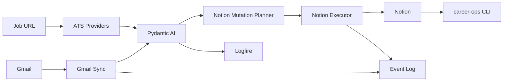

# Project State

Version: `0.1.0`
Last updated: 2026-07-08
Status: Production vertical slice complete; OSS repository foundation in progress.

## Current Architecture

Career Ops is a local Python automation platform for a software engineering job
search. Notion is the source of truth. Gmail, ATS job boards, Pydantic AI, and
Logfire are provider-backed integrations around the domain model.

## Completed Milestones

- Phase 1: Career Command Center architecture and Notion schema.
- Phase 2: Automation architecture, providers, agents, CLI, analytics.
- Phase 3: Gmail to Pydantic AI to Notion production vertical slice.
- Phase 4: Repository, documentation, OSS, and developer-experience foundation.

## In-Progress Work

- Live Gmail OAuth configuration on the target machine.
- Live Notion upsert validation against real Notion database properties.
- Logfire project/token setup for production traces.

## Outstanding Work

- Scheduled runner for unattended Gmail polling.
- Replay command for failed Notion mutations.
- `pydantic_evals.Dataset` runner around the JSON eval fixtures.
- Provider-specific API extraction for Greenhouse, Lever, Ashby, and Workday.
- Calendar integration and interview scheduling support.

## Technical Debt

- Notion gateway property mapping is intentionally conservative.
- Gmail sync uses message-id checkpointing; Gmail history-id polling is a future enhancement.
- Some agent modules are thin wrappers awaiting deeper workflows.
- Resume and recruiter agents currently reuse deterministic material helpers.

## Known Limitations

- No autonomous email sending.
- No autonomous job applications.
- Live Notion writes require `Dedupe Key` properties in target databases.
- Live Pydantic AI calls require provider credentials.

## Next Priorities

1. Configure Gmail OAuth and run `career-ops ingest-gmail --dry-run`.
2. Validate Notion live upsert in a test database.
3. Enable Logfire traces.
4. Add a scheduled daily runner.
5. Add eval runner and publish eval summaries.
