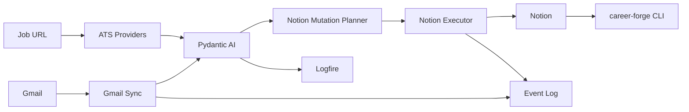

# Project State

Version: `0.3.0`
Last updated: 2026-07-08
Status: Scaffold / vertical-slice development.

## Current Phase

Scaffold / vertical-slice development.

## Immediate Objective

Get one observable, replayable workflow running locally:

```text
email -> classification -> event log -> Notion mutation plan -> optional apply
```

## Current Architecture

Career Forge is a local Python automation platform for a software engineering job
search. Notion is the source of truth. Gmail, ATS job boards, Pydantic AI, and
Logfire are provider-backed integrations around the domain model.



## Completed Milestones

- Phase 1: Career Command Center architecture and Notion schema.
- Phase 2: Automation architecture, providers, agents, CLI, analytics.
- Phase 3: Gmail to Pydantic AI to Notion production-shaped vertical slice scaffold.
- Phase 4: Repository, documentation, OSS, and developer-experience foundation.
- Phase 5: Career Forge rename and generic webhook intake foundation.
- Phase 6: Logfire workspace integration for metrics, managed variables, Gateway routing, and eval runs.

## In-Progress Work

- Typed setup validation and local dry-run operator flow.
- Gmail dry-run ingestion with OAuth configuration still manual.
- Email classification schema and Pydantic AI service boundary.
- Append-only event log for replay/debugging.
- Notion mutation planner and upsert executor.
- Live Gmail OAuth configuration on the target machine.
- Live Notion upsert validation against real Notion database properties.
- Logfire project/token setup for production traces.

## Not Yet Implemented

- Dedicated `career-forge notion plan --latest` command for broader replay workflows.
- Dedicated `career-forge notion apply --latest` command for broader replay workflows.
- Automatic scheduled Gmail polling.
- Hosted Logfire alert policies.
- Runnable `pydantic_evals.Dataset` harness.
- Gmail history-id incremental sync.
- Calendar integration.
- Autonomous email sending or autonomous job applications.
- Full provider-specific extraction for Greenhouse, Lever, Ashby, Workday,
  LinkedIn, and Indeed.
- Deep Recruiter, Resume, Interview, and Analytics agent workflows beyond
  current scaffolding/helpers.

## Outstanding Work

- Scheduled runner for unattended Gmail polling.
- Replay command for failed Notion mutations.
- `pydantic_evals.Dataset` runner around the JSON eval fixtures.
- Provider-specific API extraction for Greenhouse, Lever, Ashby, and Workday.
- Calendar integration and interview scheduling support.

## Technical Debt

- Notion gateway property mapping is intentionally conservative.
- Gmail sync uses message-id checkpointing; Gmail history-id polling is a future enhancement.
- Some agent modules are thin wrappers awaiting deeper workflows.
- Resume and recruiter agents currently reuse deterministic material helpers.

## Known Limitations

- No autonomous email sending.
- No autonomous job applications.
- Live Notion writes require `Dedupe Key` properties in target databases.
- Live Pydantic AI calls require provider credentials.

## Next Priorities

1. Configure Gmail OAuth and run `career-forge ingest-gmail --dry-run`.
2. Validate one live Notion upsert with `career-forge ingest-gmail-message`.
3. Enable Logfire traces.
4. Add a scheduled daily runner.
5. Add eval runner and publish eval summaries.
