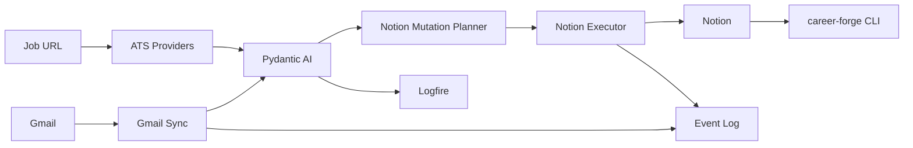

# Project State

## Public Showcase

CareerForge 0.5.0 includes a credential-free deterministic demo, reproducible
Docker entrypoint, 20-prompt benchmark, and CI verification surface. These
assets exercise the real agent and provider boundaries without changing the
live operator loop or its dry-run safety defaults.

Version: `0.5.0-unreleased`
Last updated: 2026-07-08
Status: Phase 8 local operator loop implemented; live provider validation remains manual.

## Current Phase

Phase 8: Replayable Operator Loop Hardening.

## Immediate Objective

Get one observable, replayable workflow running locally:

```text
email -> classification -> event log -> Notion mutation plan -> optional apply
```

## Current Architecture

Career Forge is a local Python automation platform for a software engineering job
search. Notion is the source of truth. Gmail, ATS job boards, Pydantic AI, and
Logfire are provider-backed integrations around the domain model.



## Completed Milestones

- Phase 1: Career Command Center architecture and Notion schema.
- Phase 2: Automation architecture, providers, agents, CLI, analytics.
- Phase 3: Gmail to Pydantic AI to Notion production-shaped vertical slice scaffold.
- Phase 4: Repository, documentation, OSS, and developer-experience foundation.
- Phase 5: Career Forge rename and generic webhook intake foundation.
- Phase 6: Logfire workspace integration for metrics, managed variables, Gateway routing, and eval runs.
- Phase 7: Logfire catalog sync for agents, prompts, LLMs, and providers.
- Phase 8: Replayable local operator loop with typed setup validation, dry-run
  Gmail safety, append-only replay metadata, latest Notion plan/apply commands,
  schema validation, expanded eval summaries, and `run-once --dry-run`.

## In-Progress Work

- Live validation of the Phase 8 loop against the user's Gmail, Notion, and
  Logfire workspaces.
- Gmail dry-run ingestion with OAuth configuration still manual.
- Live Gmail OAuth configuration on the target machine.
- Live Notion upsert validation against real Notion database properties.
- Logfire project/token setup for production traces.
- Reviewed-plan metadata for future unattended apply.

## Not Yet Implemented

- Hosted scheduled Gmail polling.
- Hosted Logfire alert policies.
- Gmail history-id incremental sync.
- Calendar integration.
- Autonomous email sending or autonomous job applications.
- Full provider-specific extraction for Greenhouse, Lever, Ashby, Workday,
  LinkedIn, and Indeed.
- Deep Recruiter, Resume, Interview, and Analytics agent workflows beyond
  current scaffolding/helpers.

## Outstanding Work

- Wire cron or launchd to `career-forge run-once --dry-run` after local
  credentials are validated.
- Exercise `career-forge notion apply --latest --no-dry-run --confirm` against
  one reviewed mutation in the live workspace.
- Provider-specific API extraction for Greenhouse, Lever, Ashby, and Workday.
- Calendar integration and interview scheduling support.

## Technical Debt

- Notion gateway property mapping is intentionally conservative.
- Gmail sync uses message-id checkpointing; Gmail history-id polling is a future enhancement.
- Some agent modules are thin wrappers awaiting deeper workflows.
- Resume and recruiter agents currently reuse deterministic material helpers.

## Known Limitations

- No autonomous email sending.
- No autonomous job applications.
- Live Notion writes require `Dedupe Key` properties in target databases.
- Live Pydantic AI calls require provider credentials.
- `run-once --apply-reviewed` is intentionally blocked until reviewed-plan
  metadata exists.

## Next Priorities

1. Run `career-forge setup validate` and fix any errors.
2. Configure Gmail OAuth and run `career-forge ingest-gmail --dry-run`.
3. Inspect `career-forge notion plan --latest`.
4. Validate one live Notion upsert with explicit confirmation.
5. Wire a local daily `career-forge run-once --dry-run` launchd or cron job.
