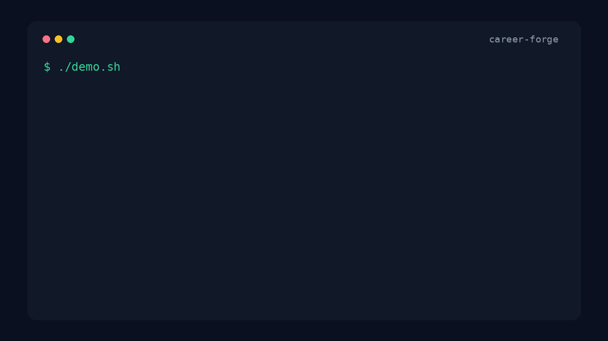
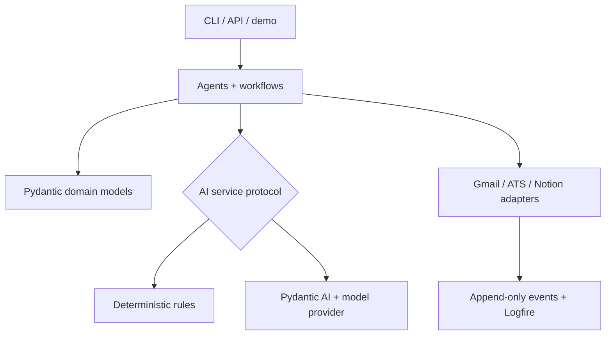

# CareerForge

### AI agents that forge career data into action.

[](https://github.com/dillon-barendt/career-forge/actions/workflows/ci.yml)
[](https://www.python.org/)
[](https://docs.pydantic.dev/)
[](LICENSE)

CareerForge is a typed, observable AI-agent platform for operating a serious
software-engineering job search. It forges raw inbox messages and job postings
into structured decisions, safe Notion mutation plans, and application
materials—while keeping external effects explicit and auditable.



## TL;DR

- **See it in one minute:** a deterministic three-agent workflow, no credentials required.
- **Trust the output:** Pydantic v2 contracts, dependency-injected providers, append-only events, and dry-run-first writes.
- **Reproduce the evidence:** Docker, 81-test CI, 81%+ core coverage, and a machine-readable 20-prompt benchmark.
- **Extend it cleanly:** application logic stays independent from Gmail, Notion, ATS, model, and observability adapters.

## Run the demo in three commands

```bash
git clone https://github.com/dillon-barendt/career-forge.git && cd career-forge
docker build -t career-forge-demo .
docker run --rm career-forge-demo
```

The demo calls the real orchestrator, Gmail ingestion pipeline, ATS provider
registry, opportunity evaluator, and material builder with fixed fake inputs.
It makes **no network calls, requires no secrets, and performs no writes**.

Already have Python 3.12 and [uv](https://docs.astral.sh/uv/)?

```bash
uv sync --extra dev
./demo.sh
```

## Three agent scenarios

### 1. Triage an interview invitation

**Prompt**

> Classify this recruiter email and propose the next safe workflow action.

**Output**

```text
classification=Interview Invitation
confidence=0.9
next_action=Reply with availability and create prep brief.
notion_write=planned
```

### 2. Evaluate a platform role

**Prompt**

> Extract this job posting, score fit, and recommend whether to prioritize it.

**Output**

```text
provider=lever
role=Principal Platform Engineer
fit_score=87
priority=High
next_action=prioritize
```

### 3. Tailor the resume

**Prompt**

> Create truthful resume-tailoring notes from the evaluated opportunity.

**Output**

```text
kind=resume_tailoring
company=Acme
preview=# Resume tailoring notes for Principal Platform Engineer at Acme
```

Get the same report as stable JSON:

```bash
./demo.sh --json
```

## Benchmark

The versioned suite contains exactly 20 prompts: 10 career-email
classification cases and 10 opportunity-evaluation cases. Success means the
typed output satisfies each case's literal classification, fit-score, and
next-action expectations—not merely that execution completed.

```bash
uv run python benchmark/bench.py --output benchmark/results.json
```

Latest local deterministic run:

| Metric | Result |
| --- | ---: |
| Success rate | 100% (20/20) |
| Median latency | 0.010 ms |
| p95 latency | 0.039 ms |
| Throughput | 73,537 prompts/s |

Results vary by hardware. The committed [JSON report](benchmark/results.json)
contains the machine-readable evidence; CI produces a fresh report artifact on
every push and pull request.

## Architecture



The design follows one rule: **business decisions do not depend on provider
implementation details**.

| Boundary | Responsibility |
| --- | --- |
| Interfaces | Typer CLI, FastAPI webhooks, demo, benchmark |
| Application | Thin agents coordinate typed pipelines |
| Domain | Pydantic v2 models encode decisions and safety metadata |
| AI services | Live Pydantic AI and deterministic implementations share protocols |
| Providers | Gmail, ATS, Notion, webhook, and observability adapters own I/O |

Read the full [architecture](ARCHITECTURE.md), [data model](DATA_MODEL.md), and
[agent catalog](AGENTS.md).

## What is implemented

- Gmail classification and idempotent Notion mutation planning
- single-message inspection and replayable dry-run/apply controls
- ATS URL normalization through provider abstractions
- structured opportunity fit evaluation and material recommendations
- append-only workflow events, Logfire metrics, prompt versions, and evals
- provider-neutral FastAPI webhook intake with verification and dedupe boundaries
- deterministic demo and 20-prompt benchmark
- Docker and CI verification for lint, format, typing, tests, coverage, smoke, and benchmark

CareerForge is production-shaped but intentionally honest about live readiness:
Gmail OAuth, Notion schemas, hosted alerting, and reviewed unattended apply
still require operator validation. See [Project State](PROJECT_STATE.md) and the
[Roadmap](ROADMAP.md).

## Live-provider setup

```bash
uv sync --extra dev
cp .env.example .env
uv run pre-commit install
uv run career-forge setup validate
```

Important live settings:

```dotenv
CAREER_FORGE_AI_PROVIDER=pydantic-ai
CAREER_FORGE_PYDANTIC_AI_MODEL=openai:gpt-5.2
CAREER_FORGE_OPENAI_API_KEY=
CAREER_FORGE_NOTION_TOKEN=
CAREER_FORGE_GMAIL_CREDENTIALS_PATH=.career_forge/gmail_credentials.json
CAREER_FORGE_GMAIL_TOKEN_PATH=.career_forge/gmail_token.json
CAREER_FORGE_LOGFIRE_TOKEN=
```

The deterministic showcase does not read these values. Live Gmail and Notion
commands remain dry-run-first:

```bash
uv run career-forge ingest-gmail --dry-run
uv run career-forge notion plan --latest
uv run career-forge notion apply --latest --dry-run
uv run career-forge events --limit 20
```

Live Notion apply requires both `--no-dry-run` and `--confirm`. Low-confidence
plans remain review-gated.

## Development

```bash
uv sync --extra dev --locked
scripts/dev_check.sh
```

The complete local gate runs:

```text
ruff check .
ruff format --check .
pyright
pytest + branch coverage (80% minimum)
JSON smoke demo
20-prompt benchmark
```

Docker is verified in GitHub Actions:

```bash
docker build -t career-forge-demo .
docker run --rm career-forge-demo ./demo.sh --json
```

## Repository guide

- [Architecture](ARCHITECTURE.md)
- [Agents](AGENTS.md)
- [Automations](AUTOMATIONS.md)
- [Data model](DATA_MODEL.md)
- [CLI](docs/CLI.md)
- [Gmail](docs/GMAIL.md)
- [Notion](docs/NOTION.md)
- [Pydantic AI](docs/PYDANTIC_AI.md)
- [Evals](docs/EVALS.md)
- [Providers](docs/PROVIDERS.md)
- [Contributing](CONTRIBUTING.md)
- [Security](SECURITY.md)

## Safety and privacy

Do not commit real job-search data, Gmail tokens, Notion tokens, resumes, or
recruiter messages. Runtime state belongs under `.career_forge/` and external
mutations must stay idempotent, observable, and explicitly confirmed.

## License

[MIT](LICENSE) © 2026 CareerForge contributors.
