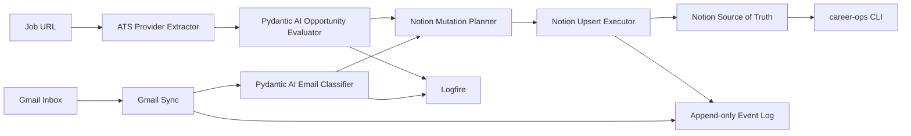

# Career Ops

Career Ops is a local automation platform for running a serious software
engineering job search. It connects a dedicated Gmail inbox, Pydantic AI,
Logfire, ATS job postings, and Notion into one observable workflow.

Notion is the source of truth. The CLI and agents reduce manual work around
triage, fit evaluation, follow-ups, interview prep, and weekly review.

## Current Implementation Status

Career Ops is currently in scaffold / vertical-slice development.

| Area | Status | Notes |
|---|---:|---|
| CLI skeleton | In progress | Core command surface exists for setup checks, dry-runs, ingestion, events, feedback, and local materials |
| Settings | In progress | Typed local configuration using `.env` and `pydantic-settings` |
| Event log | In progress | Append-only JSONL runtime state under `.career_ops/` |
| Gmail ingestion | In progress | OAuth client and dry-run sync exist; real OAuth setup remains manual |
| Email classification | In progress | Pydantic AI structured output with deterministic fallback for dry-runs/tests |
| Notion integration | In progress | Mutation planning and upsert executor exist; first live write still needs real token/database validation |
| Logfire tracing | In progress | Wrapper and feedback-loop events exist; hosted alerts still need manual setup |
| ATS providers | Scaffolded | Provider abstraction and generic extraction exist; provider-specific extraction remains shallow |
| Calendar integration | Planned | Interview scheduling and reminders are not implemented |
| Agents | Scaffolded | Agent modules exist as boundaries; deeper recruiter/resume/interview workflows are planned |

## What It Does

- dry-runs career email ingestion from `dillon.barendt.jobs@gmail.com`
- classifies messages into job-search categories
- evaluates opportunities with structured Pydantic AI outputs
- plans Notion mutations before live writes
- logs workflow events for replay and debugging
- traces AI and sync work with Logfire when configured
- ingests job URLs through a provider abstraction
- provides a daily CLI interface for action queues

## Architecture



Core principle: business logic stays independent from providers. Gmail, Notion,
Logfire, and ATS integrations are adapters around typed domain models.

## Installation

```bash
uv sync --extra dev
cp .env.example .env
uv run pre-commit install
```

Run checks:

```bash
uv run ruff check .
uv run pytest
```

## Configuration

Important settings in `.env`:

```bash
CAREER_OPS_NOTION_TOKEN=secret_xxx
CAREER_OPS_GMAIL_ACCOUNT=dillon.barendt.jobs@gmail.com
CAREER_OPS_GMAIL_CREDENTIALS_PATH=.career_ops/gmail_credentials.json
CAREER_OPS_GMAIL_TOKEN_PATH=.career_ops/gmail_token.json
CAREER_OPS_AI_PROVIDER=pydantic-ai
CAREER_OPS_PYDANTIC_AI_MODEL=openai:gpt-5.2
CAREER_OPS_OPENAI_API_KEY=
CAREER_OPS_LOGFIRE_TOKEN=
CAREER_OPS_LOGFIRE_BASE_URL=https://logfire-us.pydantic.dev
CAREER_OPS_LOGFIRE_PROJECT=dillon-barendt/career-ops
CAREER_OPS_EVENT_LOG_PATH=.career_ops/events.jsonl
CAREER_OPS_STATE_PATH=.career_ops/state.json
```

`LOGFIRE_TOKEN` is also supported as a compatibility fallback, but
`CAREER_OPS_LOGFIRE_TOKEN` is preferred for project-local configuration.

Gmail OAuth credentials and live Notion writes are intentionally manual setup
steps. Dry-run commands work without live credentials.

To populate local secrets without echoing them in your shell history:

```bash
scripts/configure_local_secrets.sh
uv run career-ops check-setup
```

## Fast Path: Local Dry Run

This is the intended first successful local workflow:

```bash
uv sync --extra dev
cp .env.example .env
scripts/configure_local_secrets.sh
uv run career-ops check-setup
uv run career-ops ingest-gmail --dry-run
uv run career-ops events --limit 20
```

## Fast Path: First Live Notion Write

The safe live-write path is:

```text
dry run -> inspect event log -> inspect mutation plan -> apply one write
```

Current working commands:

```bash
uv run career-ops ingest-gmail --dry-run
uv run career-ops events --limit 20
uv run career-ops ingest-gmail --no-dry-run
```

Dedicated `career-ops notion plan --latest` and `career-ops notion apply
--latest` commands are planned, not implemented yet. Until then, inspect the
event log and use `--no-dry-run` only after Gmail, Notion token, and database
IDs are configured.

## Tonight Vertical Slice

The first production-shaped loop is:

```text
Gmail inbox
  -> fetch recent messages
  -> classify message
  -> append event log entry
  -> generate Notion mutation plan
  -> dry-run preview
  -> apply one safe Notion upsert
  -> trace everything in Logfire
```

Everything else should hang off this loop.

## Daily Workflow

Start every day with:

```bash
career-ops today
```

Useful commands:

```bash
career-ops ingest-url "https://jobs.lever.co/example/backend"
career-ops evaluate "Senior Backend Engineer"
career-ops review
career-ops metrics
```

## Screenshots

Screenshots are intentionally placeholders until the project has stable public
demo data.

- `docs/assets/career-ops-today.png` - planned CLI daily view
- `docs/assets/notion-command-center.png` - planned Notion dashboard
- `docs/assets/logfire-trace.png` - planned Logfire trace

## Repository Guide

- [Project State](PROJECT_STATE.md)
- [Architecture](ARCHITECTURE.md)
- [Data Model](DATA_MODEL.md)
- [Automations](AUTOMATIONS.md)
- [Agents](AGENTS.md)
- [CLI](docs/CLI.md)
- [Gmail](docs/GMAIL.md)
- [Notion](docs/NOTION.md)
- [Pydantic AI](docs/PYDANTIC_AI.md)
- [Logfire](docs/LOGFIRE.md)
- [Feedback Loop](docs/FEEDBACK_LOOP.md)
- [Providers](docs/PROVIDERS.md)
- [Prompts](docs/PROMPTS.md)
- [Evals](docs/EVALS.md)
- [Roadmap](ROADMAP.md)

## Provider Status

| Provider | Status | Purpose |
|---|---:|---|
| Gmail | In progress | Career inbox ingestion and message classification |
| Notion | In progress | Source of truth and dashboard persistence |
| Logfire | In progress | Tracing, metrics, evals, and feedback loops |
| Greenhouse | Planned | Job posting extraction |
| Lever | Planned | Job posting extraction |
| Ashby | Planned | Job posting extraction |
| Workday | Planned | Job posting extraction |
| LinkedIn | Planned | Job discovery and relationship tracking |
| Indeed | Planned | Job discovery provider |
| Google Calendar | Planned | Interview scheduling and follow-up reminders |

## Roadmap

Near-term:

- validate the first live Notion upsert
- improve dry-run mutation review
- expand Logfire trace coverage and alert policies
- wrap JSON eval fixtures with a runnable eval harness
- harden provider-specific ATS extraction

Future:

- Interview Agent
- Resume Agent
- Dream Company Watch
- recruiter relationship analytics
- dashboard UI
- API server
- provider plugin marketplace

## Data Safety

Do not commit real job-search data, Gmail tokens, Notion tokens, resumes, or
recruiter messages. Runtime state belongs under `.career_ops/`, which is ignored
by Git.
