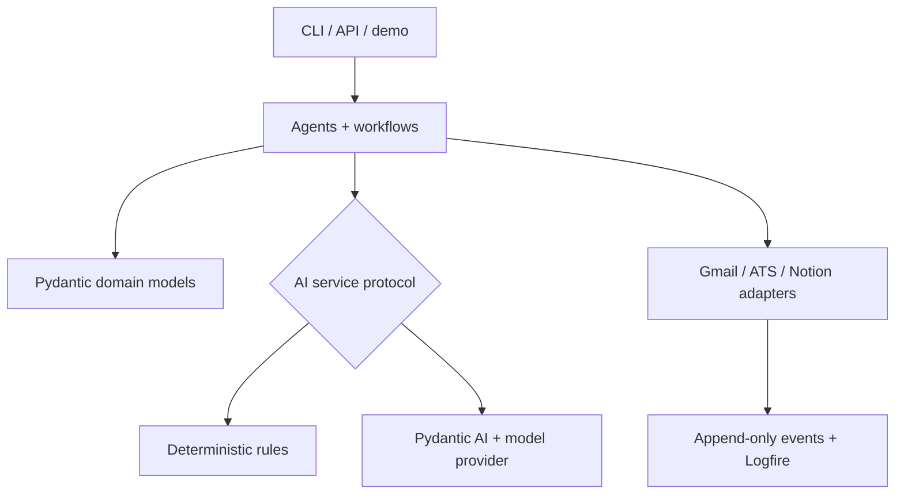

# CareerForge

### AI agents that forge career data into action.

[](https://github.com/dillon-barendt/career-forge/actions/workflows/ci.yml)
[](https://www.python.org/)
[](https://docs.pydantic.dev/)
[](LICENSE)

CareerForge is a typed, observable AI-agent platform for operating a serious
software-engineering job search. It forges raw inbox messages and job postings
into structured decisions, safe Notion mutation plans, and application
materials—while keeping external effects explicit and auditable.


## TL;DR

- **See it in one minute:** a deterministic three-agent workflow, no credentials required.
- **Trust the output:** Pydantic v2 contracts, dependency-injected providers, append-only events, and dry-run-first writes.
- **Reproduce the evidence:** Python 3.10–3.12 CI, Docker, 80%+ core coverage, and a machine-readable 20-prompt benchmark.
- **Extend it cleanly:** application logic stays independent from Gmail, Notion, ATS, model, and observability adapters.

The 0.6.0 implementation and host-side local gates are complete. Release
readiness still awaits the pull-request Actions matrix, benchmark artifact
upload, and Docker build/non-root smoke results; this branch does not claim
those remote gates have passed.

## Run the demo in three commands

```bash
git clone https://github.com/dillon-barendt/career-forge.git && cd career-forge
docker build -t career-forge-demo .
docker run --rm -e CAREER_FORGE_MODE=mock career-forge-demo
```

The demo calls the real orchestrator, Gmail ingestion pipeline, ATS provider
registry, opportunity evaluator, and material builder with fixed fake inputs.
It makes **no network calls, requires no secrets, and performs no writes**.

Already have Python 3.10–3.12 and [uv](https://docs.astral.sh/uv/)?

```bash
uv sync --extra dev
./demo.sh
```

## Three agent scenarios

### 1. Triage an interview invitation

**Prompt**

> Classify this recruiter email and propose the next safe workflow action.

**Output**

```text
classification=Interview Invitation
confidence=0.9
next_action=Reply with availability and create prep brief.
notion_write=planned
```

### 2. Evaluate a platform role

**Prompt**

> Extract this job posting, score fit, and recommend whether to prioritize it.

**Output**

```text
provider=lever
role=Principal Platform Engineer
fit_score=87
priority=High
next_action=prioritize
```

### 3. Tailor the resume

**Prompt**

> Create truthful resume-tailoring notes from the evaluated opportunity.

**Output**

```text
kind=resume_tailoring
company=Acme
preview=# Resume tailoring notes for Principal Platform Engineer at Acme
```

Get the same report as stable JSON:

```bash
./demo.sh --json
```

## Mock and real modes

Mock mode is the default. It is deterministic, credential-free, and safe for
local demos and CI:

```bash
CAREER_FORGE_MODE=mock ./demo.sh --json
CAREER_FORGE_MODE=mock uv run python benchmark/bench.py
```

Real mode is an explicit opt-in. It builds the configured Pydantic AI provider
and fails before a model call when required credentials are missing:

```bash
export CAREER_FORGE_MODE=real
export CAREER_FORGE_PYDANTIC_AI_MODEL=openai:gpt-5.2
export CAREER_FORGE_OPENAI_API_KEY='replace-with-a-secret'
uv run career-forge setup validate
```

`career_ops.ai.factory.build_ai_service()` is the single runtime selection
boundary used by the Gmail and job-ingestion pipelines. `career_ops.ai.prompts`
is the prompt-codec boundary: it owns the versioned JSON prompt builders and
the typed output parsers shared by the real adapter. Application agents depend
on the typed service protocols, not provider SDKs or raw model text.

## Benchmark

The versioned suite contains exactly 20 prompts: 10 career-email
classification cases and 10 opportunity-evaluation cases. Success means the
typed output satisfies each case's literal classification, fit-score, and
next-action expectations—not merely that execution completed.

```bash
uv run python benchmark/bench.py --output benchmark/results.json
```

Latest local deterministic run:

| JSON field | Fresh measured value |
| --- | ---: |
| `n` | 20 |
| `median_ms` | 0.0144865 |
| `p95_ms` | 0.048673 |
| `throughput_per_min` | 2,626,056.166964651 |
| `success_rate` | 1.0 (20/20) |

`details` contains 20 per-prompt records with exactly `prompt_id`,
`latency_ms`, `success`, and `error`.

Results vary by hardware. The committed [JSON report](benchmark/results.json)
contains the machine-readable evidence; CI produces a fresh report artifact on
every push and pull request.

## Architecture



The design follows one rule: **business decisions do not depend on provider
implementation details**.

| Boundary | Responsibility |
| --- | --- |
| Interfaces | Typer CLI, FastAPI webhooks, demo, benchmark |
| Application | Thin agents coordinate typed pipelines |
| Domain | Pydantic v2 models encode decisions and safety metadata |
| AI services | Live Pydantic AI and deterministic implementations share protocols |
| Providers | Gmail, ATS, Notion, webhook, and observability adapters own I/O |

Read the full [architecture](ARCHITECTURE.md), [data model](DATA_MODEL.md), and
[agent catalog](AGENTS.md).

## What is implemented

- Gmail classification and idempotent Notion mutation planning
- single-message inspection and replayable dry-run/apply controls
- ATS URL normalization through provider abstractions
- structured opportunity fit evaluation and material recommendations
- append-only workflow events, Logfire metrics, prompt versions, and evals
- provider-neutral FastAPI webhook intake with verification and dedupe boundaries
- deterministic demo and 20-prompt benchmark
- Docker packaging and CI workflows for lint, format, typing, tests, coverage, smoke, and benchmark
- explicit mock-default runtime selection with fail-fast real-provider credentials

CareerForge is production-shaped but intentionally honest about live readiness:
Gmail OAuth, Notion schemas, hosted alerting, and reviewed unattended apply
still require operator validation. See [Project State](PROJECT_STATE.md) and the
[Roadmap](ROADMAP.md).

## Live-provider setup

```bash
uv sync --extra dev
cp .env.example .env
uv run pre-commit install
export CAREER_FORGE_MODE=real
uv run career-forge setup validate
```

Important live settings:

```dotenv
CAREER_FORGE_AI_PROVIDER=pydantic-ai
CAREER_FORGE_MODE=real
CAREER_FORGE_PYDANTIC_AI_MODEL=openai:gpt-5.2
CAREER_FORGE_OPENAI_API_KEY=
CAREER_FORGE_NOTION_TOKEN=
CAREER_FORGE_GMAIL_CREDENTIALS_PATH=.career_forge/gmail_credentials.json
CAREER_FORGE_GMAIL_TOKEN_PATH=.career_forge/gmail_token.json
CAREER_FORGE_LOGFIRE_TOKEN=
```

Store real credentials in environment variables locally or encrypted GitHub
Actions secrets. The default CI jobs set `CAREER_FORGE_MODE=mock`, never expose
provider secrets, and must remain secret-free; any future real-provider job must
be separately guarded from pull requests and default CI execution.

The deterministic showcase does not read live-provider values. Live Gmail and
Notion commands remain dry-run-first:

```bash
uv run career-forge ingest-gmail --dry-run
uv run career-forge notion plan --latest
uv run career-forge notion apply --latest --dry-run
uv run career-forge events --limit 20
```

Live Notion apply requires both `--no-dry-run` and `--confirm`. Low-confidence
plans remain review-gated.

## Development

```bash
uv sync --extra dev --locked
scripts/dev_check.sh
```

The complete local gate runs:

```text
ruff check .
ruff format --check .
pyright
pytest + branch coverage (80% minimum)
JSON smoke demo
20-prompt benchmark
```

Docker verification is configured as a required GitHub Actions release gate:

```bash
docker build -t career-forge-demo .
docker run --rm -e CAREER_FORGE_MODE=mock career-forge-demo ./demo.sh --json
```

The test matrix runs the same coverage gate on Python 3.10, 3.11, and 3.12.
Only after all three pass does the Python 3.12 quality job run Ruff, Pyright,
the benchmark, host and container mock smokes, and artifact upload without
provider credentials. For 0.6.0, those pull-request results and the uploaded
benchmark artifact remain pending release evidence.

## Repository guide

- [Architecture](ARCHITECTURE.md)
- [Agents](AGENTS.md)
- [Automations](AUTOMATIONS.md)
- [Data model](DATA_MODEL.md)
- [CLI](docs/CLI.md)
- [Gmail](docs/GMAIL.md)
- [Notion](docs/NOTION.md)
- [Pydantic AI](docs/PYDANTIC_AI.md)
- [Evals](docs/EVALS.md)
- [Providers](docs/PROVIDERS.md)
- [Contributing](CONTRIBUTING.md)
- [Security](SECURITY.md)

## Safety and privacy

Do not commit real job-search data, Gmail tokens, Notion tokens, resumes, or
recruiter messages. Runtime state belongs under `.career_forge/` and external
mutations must stay idempotent, observable, and explicitly confirmed.

## License

[MIT](LICENSE) © 2026 CareerForge contributors.
