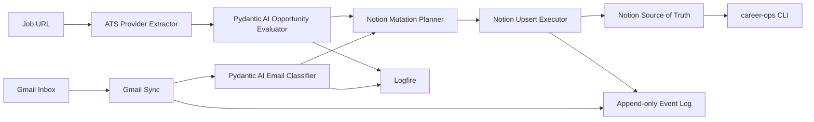

# Career Ops

Career Ops is a local automation platform for running a serious software
engineering job search. It connects a dedicated Gmail inbox, Pydantic AI,
Logfire, ATS job postings, and Notion into one observable workflow.

Notion is the source of truth. The CLI and agents reduce manual work around
triage, fit evaluation, follow-ups, interview prep, and weekly review.

## What It Does

- syncs career email from `dillon.barendt.jobs@gmail.com`
- classifies messages into job-search categories
- evaluates opportunities with structured Pydantic AI outputs
- plans and executes safe Notion upserts
- logs workflow events for replay and debugging
- traces AI and sync work with Logfire
- ingests job URLs from supported ATS providers
- provides a daily CLI interface for action queues

## Architecture



Core principle: business logic stays independent from providers. Gmail, Notion,
Logfire, and ATS integrations are adapters around typed domain models.

## Installation

```bash
uv sync --extra dev
cp .env.example .env
uv run pre-commit install
```

Run checks:

```bash
uv run ruff check .
uv run pytest
```

## Configuration

Important settings in `.env`:

```bash
CAREER_OPS_NOTION_TOKEN=secret_xxx
CAREER_OPS_GMAIL_ACCOUNT=dillon.barendt.jobs@gmail.com
CAREER_OPS_GMAIL_CREDENTIALS_PATH=.career_ops/gmail_credentials.json
CAREER_OPS_GMAIL_TOKEN_PATH=.career_ops/gmail_token.json
CAREER_OPS_AI_PROVIDER=pydantic-ai
CAREER_OPS_PYDANTIC_AI_MODEL=openai:gpt-5.2
CAREER_OPS_OPENAI_API_KEY=
LOGFIRE_TOKEN=
CAREER_OPS_LOGFIRE_TOKEN=
CAREER_OPS_LOGFIRE_BASE_URL=https://logfire-us.pydantic.dev
CAREER_OPS_LOGFIRE_PROJECT=dillon-barendt/career-ops
CAREER_OPS_EVENT_LOG_PATH=.career_ops/events.jsonl
CAREER_OPS_STATE_PATH=.career_ops/state.json
```

Gmail OAuth credentials and live Notion writes are intentionally manual setup
steps. Dry-run commands work without live credentials.

To populate local secrets without echoing them in your shell history:

```bash
scripts/configure_local_secrets.sh
uv run career-ops check-setup
```

## Daily Workflow

Start every day with:

```bash
career-ops today
```

Then run safe sync:

```bash
career-ops ingest-gmail --dry-run
career-ops events --limit 20
```

After reviewing planned behavior and credentials:

```bash
career-ops ingest-gmail --no-dry-run
```

Useful commands:

```bash
career-ops ingest-url "https://jobs.lever.co/example/backend"
career-ops evaluate "Senior Backend Engineer"
career-ops review
career-ops metrics
```

## Screenshots

Screenshots are intentionally placeholders until the project has stable public
demo data.

- `docs/assets/career-ops-today.png` - planned CLI daily view
- `docs/assets/notion-command-center.png` - planned Notion dashboard
- `docs/assets/logfire-trace.png` - planned Logfire trace

## Repository Guide

- [Project State](PROJECT_STATE.md)
- [Architecture](ARCHITECTURE.md)
- [Data Model](DATA_MODEL.md)
- [Automations](AUTOMATIONS.md)
- [Agents](AGENTS.md)
- [CLI](docs/CLI.md)
- [Gmail](docs/GMAIL.md)
- [Notion](docs/NOTION.md)
- [Pydantic AI](docs/PYDANTIC_AI.md)
- [Logfire](docs/LOGFIRE.md)
- [Feedback Loop](docs/FEEDBACK_LOOP.md)
- [Providers](docs/PROVIDERS.md)
- [Prompts](docs/PROMPTS.md)
- [Evals](docs/EVALS.md)
- [Roadmap](ROADMAP.md)

## Supported Providers

- Gmail
- Notion
- Greenhouse
- Lever
- Ashby
- Workday
- LinkedIn
- Indeed

## Roadmap

Near-term:

- scheduled Gmail polling
- Notion mutation replay
- pydantic-evals runner
- provider-specific ATS extractors
- calendar integration

Future:

- Interview Agent
- Resume Agent
- Dream Company Watch
- recruiter relationship analytics
- dashboard UI
- API server
- provider plugin marketplace

## Data Safety

Do not commit real job-search data, Gmail tokens, Notion tokens, resumes, or
recruiter messages. Runtime state belongs under `.career_ops/`, which is ignored
by Git.
