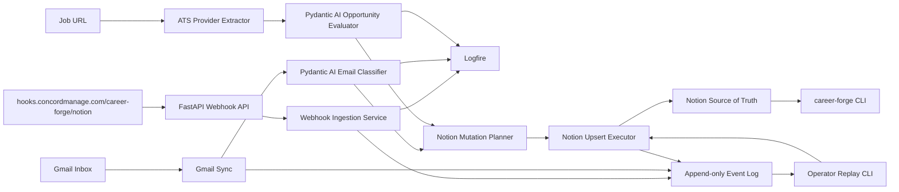

# Career Forge

Career Forge is a local automation platform for running a serious software
engineering job search. It connects a dedicated Gmail inbox, Pydantic AI,
Logfire, ATS job postings, and Notion into one observable workflow.

Notion is the source of truth. The CLI and agents reduce manual work around
triage, fit evaluation, follow-ups, interview prep, and weekly review.

## Current Implementation Status

Career Forge is currently in scaffold / vertical-slice development.

| Area | Status | Notes |
|---|---:|---|
| CLI skeleton | In progress | Core command surface exists for setup validation, dry-runs, ingestion, replay, evals, events, feedback, and local materials |
| Settings | In progress | Typed local configuration using `.env` and `pydantic-settings` |
| Event log | In progress | Append-only JSONL runtime state under `.career_forge/` with replay metadata for operator workflows |
| Gmail ingestion | In progress | OAuth client and dry-run sync exist; real OAuth setup remains manual |
| Email classification | In progress | Pydantic AI structured output with deterministic fallback for dry-runs/tests |
| Notion integration | In progress | Mutation planning, latest-plan inspection, dry-run replay, schema validation, and explicit confirmed apply exist |
| Logfire tracing | In progress | Wrapper and feedback-loop events exist; hosted alerts still need manual setup |
| Webhook API | In progress | Generic FastAPI route exists for `career-forge/notion`; durable receipt storage and hosted routing remain follow-up work |
| ATS providers | Scaffolded | Provider abstraction and generic extraction exist; provider-specific extraction remains shallow |
| Calendar integration | Planned | Interview scheduling and reminders are not implemented |
| Agents | Scaffolded | Agent modules exist as boundaries; deeper recruiter/resume/interview workflows are planned |

## What It Does

- dry-runs career email ingestion from `dillon.barendt.jobs@gmail.com`
- classifies messages into job-search categories
- evaluates opportunities with structured Pydantic AI outputs
- plans Notion mutations before live writes
- inspects and replays the latest safe Notion mutation plan
- logs workflow events for replay and debugging
- traces AI and sync work with Logfire when configured
- ingests job URLs through a provider abstraction
- provides a daily CLI interface for action queues

## Architecture



Core principle: business logic stays independent from providers. Gmail, Notion,
Logfire, and ATS integrations are adapters around typed domain models.

## Installation

```bash
uv sync --extra dev
cp .env.example .env
uv run pre-commit install
```

Run checks:

```bash
uv run ruff check .
uv run pytest
```

## Configuration

Important settings in `.env`:

```bash
CAREER_FORGE_NOTION_TOKEN=secret_xxx
CAREER_FORGE_GMAIL_ACCOUNT=dillon.barendt.jobs@gmail.com
CAREER_FORGE_GMAIL_CREDENTIALS_PATH=.career_forge/gmail_credentials.json
CAREER_FORGE_GMAIL_TOKEN_PATH=.career_forge/gmail_token.json
CAREER_FORGE_AI_PROVIDER=pydantic-ai
CAREER_FORGE_PYDANTIC_AI_MODEL=openai:gpt-5.2
CAREER_FORGE_PYDANTIC_AI_GATEWAY_ENABLED=false
CAREER_FORGE_PYDANTIC_AI_GATEWAY_API_KEY=
CAREER_FORGE_PYDANTIC_AI_GATEWAY_PROVIDER=openai
CAREER_FORGE_PYDANTIC_AI_GATEWAY_ROUTE=
CAREER_FORGE_OPENAI_API_KEY=
CAREER_FORGE_LOGFIRE_TOKEN=
CAREER_FORGE_LOGFIRE_BASE_URL=https://logfire-us.pydantic.dev
CAREER_FORGE_LOGFIRE_PROJECT=dillon-barendt/career-forge
CAREER_FORGE_LOGFIRE_METRICS_ENABLED=true
CAREER_FORGE_LOGFIRE_VARIABLES_ENABLED=true
CAREER_FORGE_LOGFIRE_INSTRUMENT_HTTPX=true
CAREER_FORGE_LOGFIRE_INSTRUMENT_OPENAI=true
CAREER_FORGE_LOGFIRE_INSTRUMENT_SYSTEM_METRICS=false
CAREER_FORGE_EVENT_LOG_PATH=.career_forge/events.jsonl
CAREER_FORGE_STATE_PATH=.career_forge/state.json
CAREER_FORGE_WEBHOOKS_ENABLED=true
CAREER_FORGE_WEBHOOKS_PUBLIC_BASE_URL=https://hooks.concordmanage.com
CAREER_FORGE_WEBHOOKS_DEFAULT_PROJECT=career-forge
CAREER_FORGE_WEBHOOKS_NOTION_ENABLED=true
CAREER_FORGE_WEBHOOKS_NOTION_SECRET=
CAREER_FORGE_WEBHOOKS_MAX_BODY_BYTES=1048576
CAREER_FORGE_WEBHOOKS_LOG_PAYLOADS=false
```

`LOGFIRE_TOKEN` is also supported as a compatibility fallback, but
`CAREER_FORGE_LOGFIRE_TOKEN` is preferred for project-local configuration.

Gmail OAuth credentials and live Notion writes are intentionally manual setup
steps. Dry-run commands work without live credentials.

To populate local secrets without echoing them in your shell history:

```bash
scripts/configure_local_secrets.sh
uv run career-forge setup validate
```

## Fast Path: Local Dry Run

This is the intended first successful local workflow:

```bash
uv sync --extra dev
cp .env.example .env
scripts/configure_local_secrets.sh
uv run career-forge setup validate
uv run career-forge ingest-gmail --dry-run
uv run career-forge notion plan --latest
uv run career-forge notion apply --latest --dry-run
uv run career-forge events --limit 20
```

## Fast Path: First Live Notion Write

The safe live-write path is:

```text
dry run -> inspect event log -> inspect mutation plan -> apply one write
```

Current working commands:

```bash
uv run career-forge ingest-gmail-message <gmail-message-id> --dry-run
uv run career-forge events --limit 20
uv run career-forge notion plan --latest
uv run career-forge notion apply --latest --dry-run
uv run career-forge ingest-gmail-message <gmail-message-id> \
  --no-dry-run \
  --mutation-index 0 \
  --confirm-message-id <gmail-message-id>
uv run career-forge notion apply --latest --no-dry-run --confirm
```

`ingest-gmail-message` does not advance the broad Gmail checkpoint and does not
acknowledge the message as processed. Live mode applies exactly one indexed
mutation and requires the message id to be repeated through
`--confirm-message-id`. The broader replay path is `career-forge notion
plan --latest` followed by `career-forge notion apply --latest --dry-run`.
Live replay requires `--no-dry-run --confirm` and refuses low-confidence plans
unless explicitly reviewed.

## Phase 8 Operator Loop

The first production-shaped loop is:

```text
Gmail inbox
  -> fetch one known message
  -> classify message
  -> append event log entry
  -> generate Notion mutation plan
  -> dry-run preview
  -> apply one safe Notion upsert
  -> trace everything in Logfire
```

Phase 8 hardens this into a local operator loop:

```bash
career-forge setup validate
career-forge ingest-gmail --dry-run
career-forge ingest-gmail-message <gmail-message-id> --dry-run
career-forge notion plan --latest
career-forge notion apply --latest --dry-run
career-forge evals
career-forge logfire-sync
career-forge run-once --dry-run
```

Safety model:

- dry-run is the default for Gmail ingestion, single-message inspection, Notion
  replay, and `run-once`
- broad Gmail dry-runs do not acknowledge messages, update checkpoints, or mark
  local state as processed
- live Notion replay requires `--confirm`
- low-confidence mutation plans carry review metadata and are refused by replay
  unless explicitly reviewed
- Notion live apply validates the target database has a `Dedupe Key` rich-text
  property before writing
- events are append-only; failed mutations are replay-eligible instead of being
  mutated in place

Local scheduled runner:

```bash
career-forge run-once --dry-run
```

Run it daily with cron or launchd once Gmail OAuth, Notion database IDs, and
Logfire configuration have been validated. `--apply-reviewed` is reserved until
reviewed-plan metadata is wired end to end.

## Daily Workflow

Start every day with:

```bash
career-forge today
```

Useful commands:

```bash
career-forge ingest-url "https://jobs.lever.co/example/backend"
career-forge evaluate "Senior Backend Engineer"
career-forge review
career-forge metrics
```

## Webhook API

The webhook API exposes a reusable route:

```text
POST /hooks/{project_name}/{source_name}
```

The first registered source is:

```text
https://hooks.concordmanage.com/career-forge/notion
  -> http://localhost:<api-port>/hooks/career-forge/notion
```

Run locally with an ASGI server such as:

```bash
uv run uvicorn career_ops.api.app:app --reload
```

Then point ngrok or the reserved public domain `https://hooks.concordmanage.com`
at the local FastAPI server. The route accepts arbitrary JSON objects, captures
redacted headers and raw-body hashes, builds a deterministic dedupe key, runs a
source verifier when configured, and returns a typed acknowledgement quickly.
Notion verification currently reports `not_configured` unless
`CAREER_FORGE_WEBHOOKS_NOTION_SECRET` is wired to a real provider verification
scheme.

## Screenshots

Screenshots are intentionally placeholders until the project has stable public
demo data.

- `docs/assets/career-forge-today.png` - planned CLI daily view
- `docs/assets/notion-command-center.png` - planned Notion dashboard
- `docs/assets/logfire-trace.png` - planned Logfire trace

## Repository Guide

- [Project State](PROJECT_STATE.md)
- [Architecture](ARCHITECTURE.md)
- [Data Model](DATA_MODEL.md)
- [Automations](AUTOMATIONS.md)
- [Agents](AGENTS.md)
- [CLI](docs/CLI.md)
- [Gmail](docs/GMAIL.md)
- [Notion](docs/NOTION.md)
- [Pydantic AI](docs/PYDANTIC_AI.md)
- [Logfire](docs/LOGFIRE.md)
- [Feedback Loop](docs/FEEDBACK_LOOP.md)
- [Providers](docs/PROVIDERS.md)
- [Prompts](docs/PROMPTS.md)
- [Evals](docs/EVALS.md)
- [Roadmap](ROADMAP.md)

## Provider Status

| Provider | Status | Purpose |
|---|---:|---|
| Gmail | In progress | Career inbox ingestion and message classification |
| Notion | In progress | Source of truth and dashboard persistence |
| Logfire | In progress | Tracing, metrics, evals, and feedback loops |
| Greenhouse | Planned | Job posting extraction |
| Lever | Planned | Job posting extraction |
| Ashby | Planned | Job posting extraction |
| Workday | Planned | Job posting extraction |
| LinkedIn | Planned | Job discovery and relationship tracking |
| Indeed | Planned | Job discovery provider |
| Google Calendar | Planned | Interview scheduling and follow-up reminders |

## Roadmap

Near-term:

- validate the first live Notion upsert against real database schemas
- run the Phase 8 loop against one real Gmail message
- expand hosted Logfire alert policies
- add reviewed-plan metadata for unattended apply
- harden provider-specific ATS extraction

Future:

- Interview Agent
- Resume Agent
- Dream Company Watch
- recruiter relationship analytics
- dashboard UI
- API server
- provider plugin marketplace

## Data Safety

Do not commit real job-search data, Gmail tokens, Notion tokens, resumes, or
recruiter messages. Runtime state belongs under `.career_forge/`, which is ignored
by Git.
