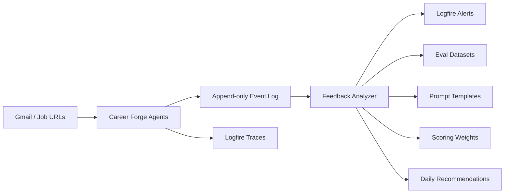

# Feedback Loop

Career Forge uses Logfire plus the append-only event log as the evaluation and
improvement layer. The loop is deliberately simple:



## Tracked Signals

The feedback analyzer reads `.career_forge/events.jsonl` and summarizes:

- email classification confidence
- opportunity fit score
- recommendation type
- human override decisions
- application outcome
- response rate
- interview conversion
- source quality
- prompt version performance
- agent failure rate

Run locally:

```bash
career-forge feedback
career-forge feedback --emit-logfire
```

Record manual outcomes:

```bash
career-forge record-outcome app_123 applied --source LinkedIn
career-forge record-outcome app_123 interview --source LinkedIn
career-forge record-override msg_123 "Company Communication" "Recruiter Outreach" \
  --prompt-version email-classifier-v1
```

## Alert Rules

Create Logfire alerts from the structured observations emitted by
`career-forge feedback --emit-logfire`.

| Alert | Signal | Default Trigger | Response |
| --- | --- | --- | --- |
| repeated classification failures | `error.retry` / `agent.failure` | same item fails 3+ times | add eval cases, require review |
| low-confidence ingestion spike | email confidence | 35%+ below 0.65 | inspect examples, tune prompt |
| Notion mutation failures | source = `notion` | any failure | check token, schema, rate limits |
| Gmail sync failures | source = `gmail` | any failure | check OAuth token and labels |
| opportunity scoring drift | fit score average | recent baseline shifts 18+ points | review scoring weights and prompt |
| stale opportunities | `stale_opportunity.detected` | any stale signal | follow up, archive, or re-score |
| poor source conversion | source quality | 3+ applications and <10% response | deprioritize that source |
| prompt regression | prompt eval pass rate | below 80% | block prompt rollout |

## Improvement Policy

Use successful and failed outcomes as follows:

- Prompt templates: promote low-confidence, overridden, and failed cases into
  prompt examples or counterexamples.
- Eval datasets: add every human override and prompt regression to the matching
  dataset before changing automation thresholds.
- Scoring weights: adjust weights only when outcomes show sustained drift, not
  from one-off bad matches.
- Provider ranking: prefer sources with higher response and interview
  conversion; demote sources with repeated low conversion.
- Daily recommendations: bias `career-forge today` toward high-quality sources,
  due follow-ups, and opportunities with proven response patterns.

## Event Contract

Feedback events should use these event types:

- `email.classified`
- `ai.evaluation.completed`
- `recommendation.issued`
- `human_override.recorded`
- `application.outcome.recorded`
- `prompt_eval.completed`
- `stale_opportunity.detected`
- `agent.failure`
- `error.retry`

Payloads should include `prompt_version`, `source`, `confidence` or
`confidence_score`, `fit_score`, `recommendation_type`, and `outcome` whenever
those fields are known.
