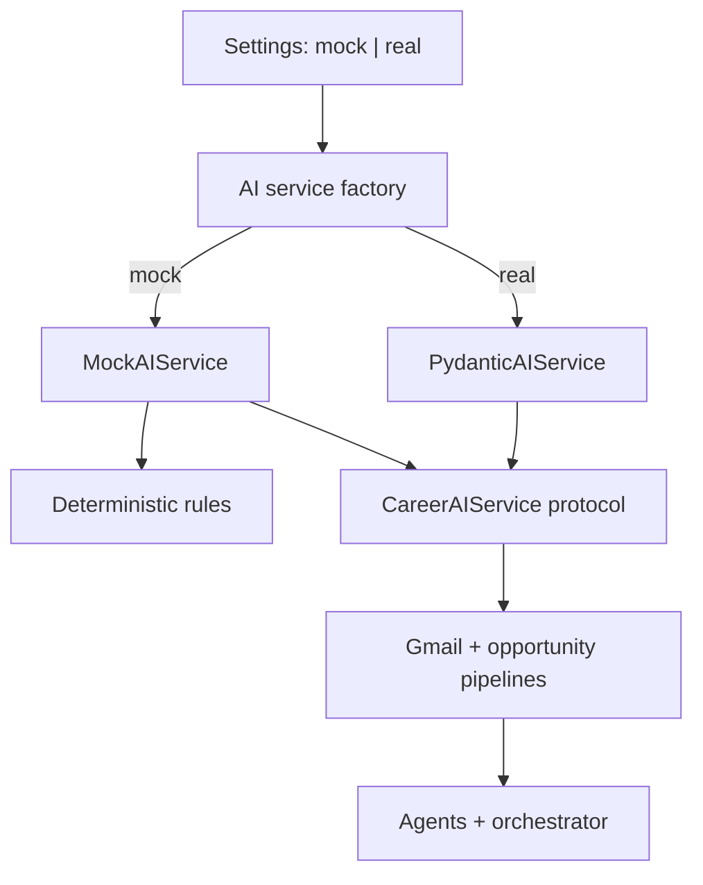

# CareerForge Mock-Mode Hardening Design

**Date:** 2026-08-24
**Status:** Approved
**Target release:** 0.6.0

## Context

CareerForge already has a public deterministic showcase, a typed AI boundary,
Docker packaging, 85 tests, a 20-prompt benchmark, and green Python 3.12 CI.
The next evaluator asks for an explicit mock-versus-real runtime contract,
configurable mock LLM behavior, a specific benchmark JSON schema, broader
Python compatibility, and integration coverage across mocked I/O boundaries.

The current implementation has three architectural gaps relevant to that goal:

1. Gmail and opportunity pipelines construct `PydanticAIService` directly when
   no dependency is supplied, so runtime mode is implicit and distributed.
2. Prompt serialization and structured-output parsing live as private methods
   inside the live Pydantic AI adapter, making them harder to validate directly.
3. Some downstream telemetry reaches back into concrete provider attributes
   instead of carrying model and fallback metadata through typed domain data.

The repository name remains `dillon-barendt/career-forge`, matching the owner's
portfolio naming convention. Product branding remains `CareerForge`.

## Goals

- Make `CAREER_FORGE_MODE=mock|real` the explicit runtime selection contract.
- Keep CI, Docker, the demo, and the benchmark deterministic and secret-free.
- Provide a configurable mock AI service that implements the production
  protocols and can model success, invalid output, and provider failure.
- Centralize provider construction and remove concrete provider knowledge from
  application pipelines.
- Make prompt building and output parsing public, focused, and directly tested.
- Support and verify Python 3.10, 3.11, and 3.12.
- Emit the evaluator's exact benchmark schema while preserving typed internal
  models and a human-readable summary.
- Add integration tests spanning orchestrator, Gmail, Notion planning, ATS
  extraction, and mock AI boundaries without external calls.

## Non-goals

- Renaming the GitHub repository, Python distribution, CLI, or product.
- Replacing Pydantic AI, the deterministic rules engine, or existing prompts.
- Exercising live Gmail, Notion, Calendar, or hosted-model credentials in CI.
- Adding a hosted demo or deployment platform.
- Refactoring unrelated workflow, webhook, analytics, or persistence modules.

## Runtime Architecture

`Settings` will validate a `mode` field as the literal values `mock` or `real`.
The default will be `mock`, ensuring a fresh clone and CI are safe by default.
The existing `CAREER_FORGE_AI_PROVIDER` setting remains provider configuration
inside real mode rather than a second runtime-mode switch.

`career_ops.ai.factory.build_ai_service()` will be the only default construction
path for a combined `CareerAIService` protocol. It will return:

- `MockAIService` in mock mode; or
- `PydanticAIService` in real mode, configured from `Settings`.

Gmail and opportunity pipelines will accept their narrow existing protocols.
When a dependency is omitted, they will ask the factory for the configured
service rather than constructing a live adapter. Explicitly injected services
continue to bypass settings and provider construction.



## AI Services and Prompt Boundary

`DeterministicAIService` remains the versioned local rules engine used by
fallback logic. It is not renamed or treated as a test double.

`MockAIService` will implement `CareerAIService` and compose the deterministic
engine for defaults. Constructor-supplied response maps and exceptions will let
tests exercise controlled provider results and failure paths without weak
`Any`-based mocks. The public fixture in `tests/fixtures/mock_llm.py` will build
common mock configurations against this production protocol.

`career_ops.ai.prompts` will own four focused functions:

- build the email-classifier prompt;
- build the opportunity-evaluator prompt;
- parse an email-classifier output into its Pydantic v2 model; and
- parse an opportunity-evaluator output into its Pydantic v2 model.

The Pydantic AI adapter will delegate to these functions. Prompt versions remain
stable and continue to be included in serialized inputs and structured results.

## Explicit Provider Metadata

`EmailClassification` will carry `model_name` and `fallback_status` alongside
its existing prompt version. `GmailIngestionPipeline` will copy these values from
the typed AI result. Gmail sync and single-message execution will read metadata
from the plan instead of assuming the injected service exposes `.model`.

This removes a concrete-provider leak that currently fails for valid protocol
implementations such as the deterministic service.

## Error Semantics

- Invalid runtime modes fail during settings validation with a precise error.
- Mock mode never reads model credentials or constructs live model clients.
- Real mode validates provider configuration at the provider boundary and
  raises an actionable configuration error when required credentials are absent.
- Explicitly injected dependencies never trigger unrelated settings reads.
- Configured mock exceptions propagate through normal pipeline error boundaries;
  they are not converted into successful canned output.
- Pydantic parsing errors retain their validation details for tests and callers.

## Python Compatibility

The project metadata will declare Python `>=3.10`. A small
`career_ops.compat` module will provide:

- `UTC` as `datetime.timezone.utc`; and
- a `StrEnum` compatible with Python 3.10.

The nine modules using Python 3.11-only `datetime.UTC` or `enum.StrEnum` will
import these compatibility definitions. Ruff and Pyright targets will move to
Python 3.10 syntax/API compatibility. CI will test 3.10, 3.11, and 3.12 so the
new lower bound does not regress the currently proven runtime.

## Benchmark Contract

The benchmark retains its 20 versioned prompt cases and typed internal case
models. The public JSON report will exactly contain:

```json
{
  "n": 20,
  "median_ms": 0.0,
  "p95_ms": 0.0,
  "throughput_per_min": 0.0,
  "success_rate": 1.0,
  "details": [
    {
      "prompt_id": "email-interview-invite",
      "latency_ms": 0.0,
      "success": true,
      "error": null
    }
  ]
}
```

Only AI-service invocation is timed; fixture loading, formatting, and expectation
validation stay outside the interval. Throughput is calculated as prompts per
minute from summed service latency. Human output reports the same fields.

## Tests

Changes will follow test-driven development. Focused tests will cover:

- settings defaults, valid modes, and invalid-mode validation;
- factory selection and credential-free mock construction;
- configurable mock results and injected failures;
- prompt serialization and structured-output parsing;
- Gmail and opportunity pipeline default construction in mock mode;
- provider metadata propagation through Gmail plans and event logs;
- orchestrator execution with mock Gmail, ATS, Notion, and AI boundaries;
- benchmark schema, percentile calculation, timing boundary, prompt execution,
  and the exact 20-case fixture;
- Python lower-bound import and package installation through the CI matrix.

Core coverage remains enforced at 80 percent or higher.

## CI and Reproducibility

`requirements-dev.txt` will provide the requested pip-compatible development
entrypoint. `uv.lock` remains the canonical reproducibility mechanism for local
development and Docker.

GitHub Actions will use a Python 3.10/3.11/3.12 matrix for package installation
and tests with `CAREER_FORGE_MODE=mock`. A single Python 3.12 quality job will
run Ruff, formatting, Pyright, the benchmark artifact, Docker build, and Docker
smoke demo to avoid repeating expensive work three times.

Docker will continue installing from `uv.lock`, running as a non-root user, and
will set mock mode explicitly. `./demo.sh` and `benchmark/bench.py` will remain
credential-free and deterministic in their documented default invocation.

## Documentation and Release

The release will update README, `.env.example`, architecture, AI-provider,
eval, roadmap, project-state, changelog, and release-checklist documentation.
Documentation will distinguish:

- mock mode for local evaluation, CI, Docker, and portfolio demonstrations; and
- real mode for operator-configured provider execution with encrypted secrets.

The existing demo GIF, social-preview artwork, three demo scenarios, license,
and community files remain unchanged unless a factual reference must be synced.
Package version and changelog will advance to 0.6.0.

## Delivery

Implementation will land on `codex/mock-mode-hardening-0.6.0` as a focused pull
request. Completion requires local verification, green GitHub Actions including
Docker, review of every changed file, and resolution of valid review feedback.
