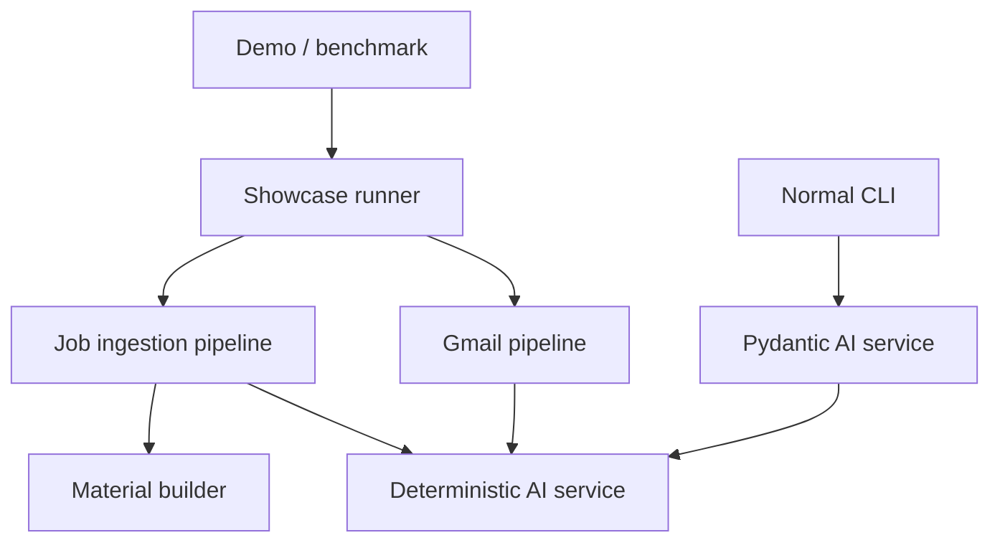

# Public AI Agent Showcase Design

## Goal

Make CareerForge immediately evaluable as a production-minded AI-agent project through a credential-free, deterministic demo, a measured 20-case benchmark, and CI that proves both paths.

## Product Positioning

Use the existing product name and the tagline **“CareerForge — AI agents that forge career data into action.”** The metaphor is defined in one sentence: the system turns raw inbox messages and job postings into typed decisions, safe mutation plans, and application materials.

The README leads with a 30–60 second terminal GIF, three commands, three prompt/output examples, measured benchmark results, and architecture. Operational setup details remain available below the public landing section.

## Architecture

The existing boundaries are sound and remain authoritative. The targeted refactor extracts the current deterministic fallback logic from `PydanticAIService` into a first-class `DeterministicAIService`. Both services satisfy small email-classification and opportunity-evaluation protocols. The Gmail and opportunity pipelines accept those protocols through dependency injection.

The showcase runner invokes the real Gmail ingestion pipeline, job provider registry, opportunity evaluation pipeline, and material builder using fixed fixtures and the deterministic service. It does not call external APIs, mutate Notion, or require credentials. Live Pydantic AI remains the default for normal application paths.

## Demo Contract

`python -m career_ops.showcase.demo` renders three fixed scenarios:

1. An interview invitation is classified and converted into a typed action plan.
2. A platform-engineering job posting is extracted, scored, and prioritized.
3. The evaluated opportunity produces truthful resume-tailoring notes.

`--json` returns the same results as a stable JSON object for smoke tests. `demo.sh` is the single executable entrypoint used locally and by Docker.

## Benchmark Contract

`benchmark/prompts.json` contains exactly 20 fixed cases across email classification and opportunity evaluation. Each case declares observable success criteria. `benchmark/bench.py` reports total cases, successes, success rate, median latency, nearest-rank p95 latency, throughput, and per-case results. It always prints a human summary and optionally writes the complete report to JSON.

Timing measures only the agent call under test. Validation and fixture construction occur outside the timed section. A failed case remains in the report and causes a non-zero exit status.

## Delivery and Safety

- Docker uses Python 3.12 and installs only the package required for the demo.
- No secrets are required for demo or benchmark mode.
- `.env.example` documents live-provider credentials separately from deterministic showcase mode.
- CI runs Ruff lint and format checks, Pyright, pytest with coverage, the JSON smoke demo, the benchmark, and a Docker build/run.
- The GIF contains generated fake data only.
- Existing live-provider, Notion safety, event-log, and CLI contracts remain unchanged.

## Testing

Use TDD for every behavioral change:

- deterministic service parity and malformed-input behavior;
- protocol-based injection through Gmail and job pipelines;
- stable human and JSON demo output;
- benchmark aggregation, p95 calculation, output persistence, and failure status;
- Docker/demo smoke behavior through direct script execution.

Static configuration and human-facing prose are verified by executing their consumer paths, not by source-text assertions.

